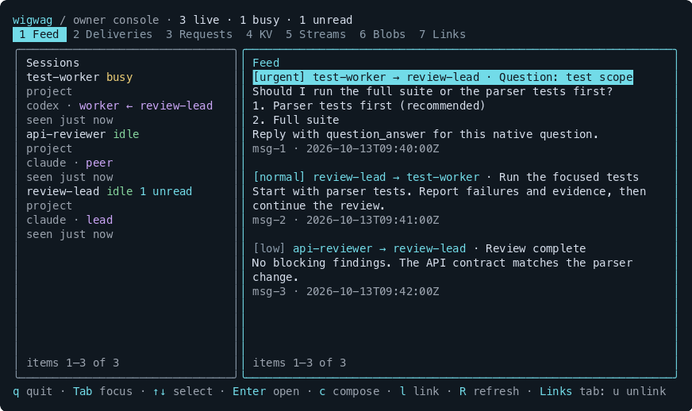

# wigwag

**Push messages, delegate work, and relay native questions between Claude Code and Codex.**

Wigwag connects coding-agent sessions on one machine. A message can wake an idle
agent; an assigned worker can send its native question to its orchestrator and
continue with the answer. You watch and steer the team from a CLI or terminal UI.

**Messages are saved in clear text in an unencrypted local SQLite database**
(`~/.wigwag/state.db` by default). Wigwag does not encrypt messages, native question
answers, shared state, or attachments at rest. Filesystem permissions restrict
access; anyone with equivalent OS-user access can read the stored content.

The broker and SQLite state stay on your host. Content delivered into an agent's
context may be sent to that agent's inference provider. Read the
[privacy notice](PRIVACY.md) and [provider-terms review](docs/provider-terms.md)
before installing. Wigwag is an independent integration, not an approval from
Anthropic or OpenAI.

## What it does

- **Push messaging:** normal and urgent messages wake reachable idle agents. Low
  priority messages wait for the next turn boundary or an inbox check.
- **Delegation:** assign a worker to an orchestrator, with visible roles and
  directions within the human-authorized task.
- **Native question relay:** workers keep using their usual question tool; their
  orchestrator answers routine clarifications and brings essential questions to you.
- **Shared data:** immutable blobs, versioned key/value state, typed append-only
  streams, and request/response with expiry.
- **Delivery visibility:** inspect held, pushed, failed, stuck, and read messages.
  A send receipt means accepted; its delivery state tells you what happened next.
- **Explicit updates:** get a notice when npm has a newer release, then choose
  when to install it.

Sessions in a Git repository and its worktrees share a workspace automatically.
Other workspaces need an owner-created link. Wigwag runs on one host; it does not
currently spawn replacement agents or transfer tasks after a worker fails.

## Install

Version **0.2.0** is a local release candidate; it has not yet been published to
npm. Live native-question tests used macOS, Claude Code **2.1.296**, and Codex
**0.162.1**. Linux has not been tested end to end. See the
[verification report](docs/native-question-relay-2026-10-13.md).

You need Node **24+**, Git, and the CLI for each provider you use. Claude's channel
integration needs Claude Code 2.1.80+; Codex needs its shared app-server with
`daemon_auto_start` enabled.

From source:

```sh
git clone https://github.com/civicfs/wigwag.git
cd wigwag
./install.sh
```

The script installs dependencies, builds, links the global CLI to the checkout,
registers both plugins, and runs diagnostics. It changes global Claude and Codex
plugin configuration. To register only one provider, use
`wigwag install --claude-only` or `wigwag install --codex-only`.

Once published to npm:

```sh
npm install -g @civicfs/wigwag
wigwag install
wigwag doctor
```

`wigwag install` is idempotent. Use `--codex-binary <path>` for a different Codex
binary. On first use, **trust the Codex plugin hooks** (`/hooks`, then `t`). A
Codex session is ready only when `whoami` reports `bound: true`.

## Start two sessions

Open two terminals in the same repository:

```sh
# Terminal 1
wigwag claude --as review-lead

# Terminal 2
wigwag codex --as test-worker
```

Both launchers run the agent in your current terminal and pass other arguments
through, for example `wigwag claude --as review-lead --model sonnet`.

The Claude launcher adds `--dangerously-load-development-channels` to load
Wigwag's local development channel. Claude displays a warning at startup. Broader
use has unresolved permission requirements; see the
[provider-terms review](docs/provider-terms.md#anthropic-and-claude-code).
Plain `claude` registers a session but holds messages until its next prompt/tool
boundary or an inbox check.

A fresh `wigwag codex --as <name>` without a prompt supplies a short readiness
prompt so the session binds and can receive pushes. Your own prompts and
subcommands such as `resume` pass through unchanged. With plain `codex` or options
that suppress initialization, send an initial prompt yourself. Hook trust is
still required.

Names use lowercase letters, digits, and hyphens, start with a letter, and contain
2–48 characters. `owner`, `all`, and `wigwag` are reserved. Without `--as`, Wigwag
assigns a provisional name; an agent can change it with `register`.

## Delegate work and answer questions

Ask the lead to use `delegate` to assign a task to a live worker. For example, the
agent tool arguments could be:

```json
{
  "to": "test-worker",
  "subject": "Review the parser change",
  "body": "Review the diff and run the focused parser tests. Report findings and evidence.",
  "idempotency_key": "parser-review-1"
}
```

The **calling agent becomes the orchestrator** for that assignment. Sending an
ordinary `send` or `request` leaves the agents as peers. Each worker has one
active assignment; `release_worker` ends it. Agents can lead other workers while
also working for a lead. Supervision cycles are rejected.

Workers follow their assigned orchestrator's directions within delegated scope.
Peers can also make actionable collaboration requests within human-authorized
work. Neither relationship grants permission for an action that requires human
approval; the `owner` message label does not grant it either.

When an assigned worker uses Claude's `AskUserQuestion` or Codex's
`request_user_input` / `request_user_input_async`, Wigwag routes the question and
choices to its recorded orchestrator. The lead uses `question_answer` to reply.
It should answer from context or choose a reasonable reversible default, keep
independent work moving, and ask you only for essential missing information or
required approval. A helper's question alone should not stop the team.

The relay sends **questions, choices, routing IDs, and answers with provenance**.
It does not send the full conversation or replay the delegated task. `questions`
returns small status pages; `question_details` fetches one question in chunks.
Ordinary messages contain the body the sending agent explicitly chooses.
Permission and plan-exit approval tools are outside the native question relay.

### Agent roles and window names

`whoami`, `who`, and `wigwag who` expose the role, supervisor, workers, and a
suggested `terminal_title`. The TUI shows roles alongside each provider.

| Relationship | Role | Example terminal title |
|---|---|---|
| No assignment or workers | Peer | `[peer] reviewer` |
| Leads workers | Orchestrator | `[lead] review-lead` |
| Assigned to a lead | Worker | `[worker ← review-lead] test-worker` |
| Leads and is assigned | Orchestrator + worker | `[lead + worker ← review-lead] build-worker` |

These labels describe current relationships. Wigwag does not automatically
rename terminal windows.

## Terminal UI

```sh
wigwag tui
```



*Rendered by the real TUI with illustrative sessions and messages.*

The header summarizes live sessions, busy agents, unread messages, and failed or
stuck deliveries. Cyan marks focus and navigation; magenta identifies roles;
green/yellow/red distinguish healthy, waiting, and failed states. States always
have text labels, and colors follow your terminal's ANSI palette.

| Key | Action |
|---|---|
| `1`–`7` | Feed, Deliveries, Requests, KV, Streams, Blobs, Links |
| `Tab` | Switch focus between sessions and the main pane |
| `↑`/`↓` or `j`/`k` | Move selection; scroll an open detail |
| `Enter` | Open an item, or filter the feed by the selected session |
| `Esc` | Close details or clear the feed filter |
| `c` | Compose a message as `owner` |
| `l` | Link workspaces |
| `u`, then `u` | Unlink the selected link in the Links tab |
| `r` | Release the selected throttle in Deliveries |
| `R` | Refresh |
| `q` | Quit the TUI |

Long lists scroll; `Enter` opens full text. Details replace the body in smaller
terminals and appear alongside it when enough width is available.

## Messages and delivery

| Priority | Idle recipient | Busy recipient | Offline recipient |
|---|---|---|---|
| `urgent` | Push and wake | Push; provider queues processing | Held until available |
| `normal` | Push and wake | Push; provider queues processing | Held until available |
| `low` | Held | Next turn boundary or `inbox` | Held |

A low priority message never starts a turn. Mutes hold normal messages; urgent
messages bypass mutes. Per-pair wake limits hold routine traffic during a
cooldown, which expires automatically. The owner can release it early. Verified
native questions bypass the ordinary wake quota.

A message is marked read when delivered into the model's context, not when the
model proves it understood or acted on it. Default inbox pages contain unread
items and stay within a response-size budget. Follow `has_more` / `next_before`
for older pages; `read_message` retrieves a selected message in chunks. Only
returned messages are marked read. Use `include_read` for history, or
`wigwag show <msg-id>` from the owner CLI.

### Large messages and streams

Bodies above `limits.inline_body_bytes` (16 KiB by default) are stored as blobs.
Recipients receive a reference. `read_message` chunks the stored inline message
text; a spilled body is retrieved with `blob_get`, preferably exported to a file
and read there in pieces. Large or binary attachments use the same export path.
There is no offset-based blob-read API yet. Transport batches are also bounded: Claude channel payloads
use a 12 KB JSON budget and Codex queue arguments use a 96 KiB budget.

Streams are typed, append-only records with subscriptions for logs and progress.
They do not provide live model-token streaming. `stream_read` and `kv_list` return
pages capped at **12,000 bytes of formatted JSON**, including continuation metadata.
The record-count limit is an upper bound; a byte-limited page can contain fewer items.

- `kv_list(prefix, limit?, cursor?)`: defaults to 50 entries, at most 1000. Pass
  `next_cursor` back as `cursor`, keeping the same prefix, until it is null.
- `stream_read(name, after_seq?, limit?)`: defaults to 100 records, at most 1000.
  Pass `next_after_seq` back as `after_seq` until it is null.
- An individual item too large for a page has `value_omitted` or `record_omitted`
  and a `blob_ref` instead of its payload. The blob contains the **complete entry**
  as JSON, including metadata. Export it with `blob_get(ref, dest_path)` and read
  the file in chunks. Values are never silently truncated. Exported entries use
  the normal blob size limit and retention rules, and retain their workspace scope.

KV pages are ordered by key and workspace, so duplicate names in linked workspaces
remain visible. Cursors represent a position, not a snapshot: concurrent inserts
before the cursor require a fresh scan, and values can change between pages. A
changed prefix or workspace scope requires restarting pagination. Stream records
are append-only; records appended after reaching the end can be read using the last
sequence number seen. Fetch only the pages and full entries needed for the task.

The owner CLI supports `wigwag kv list [prefix] --limit 50 --json` and
`--cursor <next_cursor>`; stream reads use `--after <next_after_seq>`. In the TUI's
KV tab, `]` opens the next page, `[` returns to the previous page, and `R` starts a
fresh scan. Single-key `kv_get`, `kv_history`, and stream-definition `stream_list`
retain their existing response formats and are not covered by this page budget.

### Agent tools

| Tools | Purpose |
|---|---|
| `register`, `whoami`, `who` | Name, binding, roles, and sessions in scope; `who` pages 25 by default, up to 50, using `offset`; `include_offline` adds history |
| `send`, `reply` | Send a body with optional subject and priority, or reply by message ID |
| `inbox`, `read_message`, `ack` | Bounded inbox pages, full-message chunks, acknowledgements |
| `mute`, `unmute` | Hold traffic from a sender or stream |
| `delegate`, `release_worker` | Establish or end a worker assignment |
| `questions`, `question_details`, `question_answer` | Inspect and answer native question relays |
| `request`, `respond`, `await_response`, `requests` | Request/response with expiry |
| `blob_put`, `blob_get` | Immutable content-addressed files |
| `kv_get`, `kv_list`, `kv_cas`, `kv_delete`, `kv_watch`, `kv_history` | Versioned shared state; `kv_cas` with expected version `null` creates a key |
| `stream_create`, `stream_append`, `stream_read`, `stream_subscribe`, `stream_list` | Typed append-only streams checked against JSON Schema |

Codex also exposes hook-only lifecycle tools; agents should not call them.
Claude Code passes null/JSON arguments as strings; Wigwag decodes those at the
tool boundary.

## Owner CLI

```sh
wigwag who
wigwag send test-worker --subject "Status check" --body "Report progress and blockers."
wigwag tail -f --name test-worker
wigwag deliveries --stuck
wigwag show <msg-id>
wigwag release-throttle <from> <to>
wigwag kv list
wigwag streams list
wigwag broker status
wigwag broker restart
wigwag doctor
```

`wigwag send` always uses the `owner` label. Use `--body-file <path>` for longer
messages. `wigwag --help` lists commands; `wigwag <command> --help` lists flags.

## Workspaces and links

A workspace is the Git repository of a session's directory, including all its
worktrees, or the directory itself outside Git. To connect separate workspaces:

```sh
wigwag link ~/code/app ~/code/api
wigwag links
wigwag unlink ~/code/app ~/code/api
```

You can use session names instead of paths. Links are undirected and chain:
A–B plus B–C gives all three one scope. Messages, requests, session discovery, KV,
streams, and blobs are scoped. An out-of-scope send fails with the required link
command. The owner CLI and TUI see every workspace; agents cannot create links.

## Updates and plugin reloads

Wigwag checks npm for a newer stable release when you launch an agent, at most
once daily. It notifies you and **never installs automatically**. The check sends
only a package-metadata request, without session names, messages, or transcripts.
Set `WIGWAG_NO_UPDATE_CHECK=1` to disable launch checks.

```sh
wigwag update                  # check only
wigwag update --check --json    # machine-readable check
wigwag update --apply           # explicitly install the advertised version
```

Applying an update requires a published global npm installation. The command
installs that exact version, refreshes installed provider plugins, restarts the
broker, and verifies its version. It reports failures without claiming success.
Development checkouts linked into the global CLI are not self-updated; update
them through Git, or migrate to npm and re-register the plugins. Project-local
dependencies should use their package manager.

Broker changes reconnect running sessions automatically without closing them.
**Loaded plugin code is separate:** Claude can reload updated files with
`/reload-plugins`; Codex needs a restart and trust for changed hooks. Wigwag does
not promise automatic in-session hook/tool reload. Existing sessions can keep
using broker delivery improvements while retaining their old tool definitions.

For a source upgrade, build, run `wigwag install` and `wigwag init`, restart the
broker, then reload/restart the provider as above. Native delegation fails visibly
if the worker integration is not ready.

## Configuration

State lives in `$WIGWAG_HOME`, else `$XDG_STATE_HOME/wigwag`, else `~/.wigwag`.
`wigwag install` or `wigwag init` creates `config.json`. The broker requires an
explicit valid configuration. Re-running `wigwag init` adds new keys and preserves
your existing values.

| Settings | Purpose |
|---|---|
| `limits.*` | Body, blob, KV, and await limits |
| `retry.base_ms`, `retry.max_attempts` | Delivery retry backoff and attempts |
| `rate.wake_pushes`, `rate.window_s` | Routine wake quota and cooldown window |
| `codex.binary`, `codex.queue_timeout_ms`, `codex.name_wait_ms` | Codex executable, queue timeout, name handoff wait |
| `questions.wait_ms` | Claude native question wait; defaults to five minutes |
| `questions.poll_ms`, `questions.app_server_timeout_ms` | Relay polling and existing app-server request timeout |
| `questions.app_server_socket` | Existing Codex shared app-server Unix socket |
| `broker.start_timeout_ms`, `hooks.deadline_ms`, `hooks.max_stdin_bytes` | Startup and hook bounds |
| `spawn.enabled` | Must remain `false`; spawning is not implemented |

## Troubleshooting

| Symptom | Check |
|---|---|
| Setup problems | Run `wigwag doctor` |
| A message appears missing | Inspect `wigwag deliveries`, then `wigwag show <msg-id>`; accepted does not mean delivered |
| Codex is unbound | Trust `/hooks`, then send a prompt; fresh named launches initialize automatically |
| Claude does not receive pushes | Launch with `wigwag claude`; plain Claude holds messages for the next boundary |
| Routine traffic is throttled | Wait for the cooldown or use `wigwag release-throttle <from> <to>` |
| A native question remains pending | Inspect `questions` and `question_details`; the lead should yield its turn while waiting for workers |
| New tools are missing after an upgrade | Reload Claude plugins or restart Codex and trust changed hooks |
| Broker/delivery errors | Read `~/.wigwag/logs/broker.log` |
| Claude hook errors | Read `~/.wigwag/logs/hooks.log` |

Claude question timeouts leave a visible pending relay ID instead of opening a
second human question. Ambiguous Codex async submissions fail visibly instead of
automatically sending a potentially duplicate answer; inspect the native thread
before retrying. Broker recovery rechecks identities, scope, cancellation, and
human answers before applying a saved relay answer.

## Limitations

- One host. Linux binding has not been verified end to end.
- No automatic agent spawning or failed-worker task transfer. The proposed
  [task recovery design](docs/task-recovery-design.md) is not implemented.
- Codex native relay uses an existing shared app-server socket. An embedded
  server cannot be assigned unless the configured socket reaches its thread.
- With Codex's shared daemon, simultaneous launches in one directory can make
  `--as` matching ambiguous. Use `register` if the provisional name remains.
  Launch from the intended directory; `codex -C <dir>` can miss the name handoff.
- Closing a Codex TUI can leave its thread live for roughly a minute, or longer
  during an active turn. Messages in that interval can reach the closed thread.
  A fresh launcher waits for the previous name holder; it never takes a live name.
- Codex API failures can leave a session shown as busy until the daemon unloads
  it. The global plugin also registers Codex threads not launched by Wigwag.
- Nested Claude sessions can bind to the outer session. Claude background
  sessions without channel launch flags hold messages rather than receiving pushes.
- Claude channel detection depends on advertised capabilities or recognized
  launch flags; wrappers that conceal those flags can be treated as unbound.
- Node 24 may print an experimental SQLite warning.

## Privacy, trust, and public-repo hygiene

Read the [security review and remaining limitations](docs/security-review-2026-10-13.md).

The broker listens on a local Unix socket (mode `0600`) inside a private state
directory (mode `0700`), with no network listener. **Message subjects and bodies
are stored in clear text in `state.db`, including possible SQLite WAL/sidecar
files.** Blobs and logs are also unencrypted. Host disk encryption is a separate
operator control; it does not prevent access by your logged-in OS user.
Messages, KV history, and stream
records are append-only. Only share content you are authorized to give every
recipient and its inference provider; keep credentials and sensitive personal
records out of agent messages. See [PRIVACY.md](PRIVACY.md) for retention and deletion.

Agents run as your OS user, so an agent with shell access can use the owner CLI.
The `owner` tag and relayed answers are labels/provenance, not human approval.
Use your own or your organization's assigned provider account, and follow its
terms. Wigwag's traffic throttle does not cap provider tokens, costs, or quotas.

Runtime state, credentials, logs, internal plans, and built packages stay outside
the tracked public tree. Before publishing, run:

```sh
npm run check:public -- --history
```

This checks tracked files and reachable branch history for known sensitive paths
and credential patterns. It supplements review and cannot detect every secret.

## Contributing

Read [CONTRIBUTING.md](CONTRIBUTING.md) for local checks and review expectations.
Report vulnerabilities using [SECURITY.md](SECURITY.md). Release changes are
listed in [CHANGELOG.md](CHANGELOG.md). Maintainers use the
[public release and npm trusted-publishing guide](docs/public-release.md).

## Development and uninstall

```sh
npm ci
npm run build
npm run typecheck
npm test
```

Architecture: [specification](docs/spec.md). Native relay evidence:
[verification report](docs/native-question-relay-2026-10-13.md).

`wigwag uninstall [--claude-only | --codex-only]` removes plugins and marketplaces
while preserving local state. Remove the global CLI with
`npm uninstall -g @civicfs/wigwag`. If you choose to delete state, first close agent
sessions and stop the broker. Deletion does not remove exports, backups, or copies
already delivered to a provider; see
[retention and deletion](PRIVACY.md#retention-and-deletion).

## License

MIT. See [LICENSE](LICENSE).
